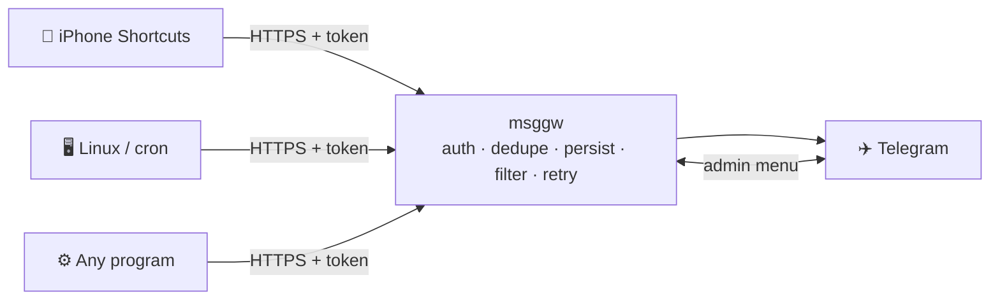

<div align="center">

# 📨 msggw

**A small, self-hosted message gateway: collect notifications from your phone, servers and scripts, and deliver them to Telegram — reliably.**

English · [简体中文](README.zh-CN.md)


</div>

---

## Why

Forwarding SMS and alerts to Telegram is easy to hack together, but hard to trust. A quick script can silently drop a message when Telegram is down, or report "sent" when it wasn't. **msggw** is a single Go binary that takes delivery seriously. It stores every message before acknowledging it and retries until Telegram confirms receipt. It is honest about every state in between: *accepted*, *delivered*, *failed* or *uncertain*.



## Features

- **Reliable delivery**: messages are committed to SQLite (`synchronous=FULL`) before the client gets a response. A persistent outbox retries with backoff for up to 24 h. Delivery is at-least-once: when an attempt's outcome is unknown, msggw resends rather than risk losing the message, and marks it *uncertain*.
- **Per-source credentials**: each device or script gets its own token, which can be disabled, rotated or revoked independently. The source identity comes from the token and cannot be spoofed in the payload.
- **Dedupe and idempotency**: `Idempotency-Key` support, plus content-based dedupe within a configurable window.
- **Clean notifications**: the message text contains only the content, so lock-screen previews show what matters. Source and type appear as inline buttons; tapping one shows the message details.
- **Admin bot**: a menu-driven Telegram bot (Chinese UI) for system overview, bot and server health, sources, statistics and settings. It is admin-only, private chats only, and silent in groups.
- **Optional AI SMS filter**: [DeepSeek](https://www.deepseek.com/) classifies SMS. Ads, spam and roaming / customs reminders are held back but can be rescued from the bot for 7 days.
  - Verification codes are detected locally and **never** sent to the AI.
  - Other messages have digits and links masked before classification.
  - Any AI failure means the message is forwarded as usual.
- **Privacy by default**: message bodies are deleted as soon as delivery finishes, with `secure_delete` and hourly WAL truncation. Logs never contain message content or credentials.
- **Batteries included**: built-in Let's Encrypt (autocert), a hardened systemd unit with watchdog, honest health reporting ("unknown" is never shown as "healthy"), and a read-only admin API.
- **Tiny footprint**: about 19 MB RSS and 0.01% CPU when idle, on a 1 vCPU / 1 GB VPS. No Docker, no external services.

## How a message looks in Telegram

```
❗ China Merchants Bank
Your verification code is 123456, valid for 5 minutes.

 [ 📱 iPhone ]  [ 💬 短信 · 验证码 ]      ← inline buttons; tap for details
```

## Quick start

**Requirements:** a Linux host with systemd, Go ≥ 1.27 to build, a domain pointing at the host, and ports 80/443 open (80 is needed for Let's Encrypt).

```bash
# 1. Build and install (creates the msggw user, systemd unit and /etc/msggw/msggw.env)
sudo ./deploy/install.sh

# 2. Configure: domain, Telegram bot token (from @BotFather), your Telegram user ID
sudo nano /etc/msggw/msggw.env
sudo systemctl restart msggw

# 3. Self-check and send a test message
sudo msggw check --send-test

# 4. Create a source and note its token (shown once)
sudo msggw source add iphone --name iPhone --icon 📱
```

Send your first message:

```bash
curl "https://your.domain/v1/messages?wait=8" \
  -H "Authorization: Bearer mgs_..." \
  -H "Content-Type: application/json" \
  -d '{"title": "Hello", "body": "First message 👋", "type": "sms"}'
```

```json
{ "ok": true, "message": "已送达 Telegram", "status": "delivered", "delivered": true, "id": "m_01JB7Q..." }
```

`ok: true` only means *accepted*. Check `delivered` to know whether Telegram actually received the message.

## Sending messages

`POST /v1/messages` accepts JSON or `text/plain`:

| Field | Description |
|---|---|
| `title` | Optional, single line (e.g. the SMS sender) |
| `body` | Message text; Chinese, Japanese and emoji are fully supported; long messages are split automatically |
| `type` | `sms`, `notification`, `alert`, `task`, `log`, … (free-form, shown as a label) |
| `priority` | `low` (silent), `normal`, `high` (❗) |
| `occurred_at` | Device-side timestamp (informational only) |
| `meta` | Up to 16 extra key/value pairs |

Add `?wait=N` (≤ 25 s) to wait for the real delivery result. This is handy for iPhone Shortcuts, which can simply display the `message` field.

See the [API reference](docs/api.md) for status queries, error format and the admin API.

## SMS filter (optional)

Add a DeepSeek API key to enable it:

```bash
MSGGW_DEEPSEEK_API_KEY=sk-...
```

| Category | Default |
|---|---|
| Verification code · Bank/payment · Parcel/travel · Personal · Service notice | ✅ forwarded, with the category shown on the button |
| Roaming / customs reminders · Marketing · Spam | 🗑 held back, can be forwarded from the bot (`/filtered`) for 7 days |

Details, privacy notes and tuning: [docs/sms-filter.md](docs/sms-filter.md).

## Configuration

All settings live in `/etc/msggw/msggw.env` (see [`deploy/msggw.env.example`](deploy/msggw.env.example)):

| Variable | Default | |
|---|---|---|
| `MSGGW_DOMAIN` | — | Domain for the Let's Encrypt certificate |
| `MSGGW_TELEGRAM_BOT_TOKEN` | — | Bot token from @BotFather |
| `MSGGW_TELEGRAM_ADMIN_IDS` | — | Comma-separated numeric Telegram user IDs |
| `MSGGW_TIMEZONE` | `Asia/Tokyo` | Display timezone |
| `MSGGW_DELIVERY_MAX_AGE` | `24h` | How long to keep retrying |
| `MSGGW_RETENTION_DAYS` | `30` | Metadata retention (bodies are deleted right after delivery) |
| `MSGGW_DEEPSEEK_API_KEY` | — | Enables the SMS filter |

Full list: [docs/deployment.md](docs/deployment.md#3-配置项).

## CLI

```text
msggw serve                         run the service (used by systemd)
msggw check [--send-test]           validate config, database, Telegram and DeepSeek
msggw source list|add|show|set|enable|disable|rotate|remove
msggw admin-key create|list|revoke  read-only admin API keys
msggw version
```

## Documentation

The detailed documentation is written in Chinese.

| | |
|---|---|
| [Deployment](docs/deployment.md) | Install, configuration, upgrade, backup, uninstall |
| [Telegram bot](docs/telegram-bot.md) | Bot setup, menus, permissions |
| [iPhone Shortcuts](docs/iphone-shortcuts.md) | Manual sending and SMS automation; iOS limitations |
| [API reference](docs/api.md) | Endpoints, status values, error format |
| [Message model](docs/message-model.md) | Unified message format, states, rendering |
| [SMS filter](docs/sms-filter.md) | DeepSeek classification, privacy, rescue |
| [Adding sources](docs/adding-sources.md) | Linux, Windows, macOS, Android examples; new output channels |
| [Architecture](docs/architecture.md) | Modules, persistence, delivery state machine, health model |
| [Operations](docs/operations.md) | Monitoring and troubleshooting |
| [Security](docs/security.md) | Credentials, hardening, privacy risks |
| [Limitations](docs/limitations.md) | Known limitations and roadmap ideas |
| [Testing](docs/testing.md) | Automated tests and production verification results |

## Development

```bash
make test     # unit + integration tests
make race     # all tests with the race detector
make vet      # gofmt + go vet
make build    # build bin/msggw
```

The tests use an in-process fake Telegram Bot API (`internal/testutil/faketg`) and a fake DeepSeek endpoint, so they never touch the network.

<details>
<summary>Project layout</summary>

```text
cmd/msggw/            entry point and CLI
internal/config       configuration loading and validation
internal/model        unified message model and states
internal/auth         tokens, hashing, content fingerprints
internal/store        SQLite persistence (sources, messages, deliveries, stats)
internal/httpapi      HTTP API, auth, rate limiting, HTTPS/autocert
internal/router       message → delivery targets
internal/filter       SMS filter: code detection, masking, DeepSeek client
internal/delivery     persistent outbox, retries, Telegram channel
internal/render       message → Telegram text and buttons (escaping, splitting)
internal/telegram     minimal Telegram Bot API client
internal/bot          admin bot (menus, permissions, views)
internal/health       health tracking and component evaluation
internal/status       status and statistics queries
internal/sysinfo      server metrics from /proc and statfs
internal/ratelimit    rate limiting and auth-failure blocking
internal/sdnotify     systemd readiness and watchdog
internal/app          wiring and lifecycle
deploy/               systemd unit, config template, install script
```

</details>
