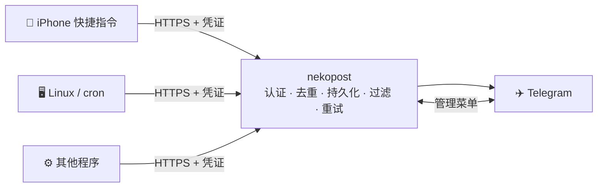

<div align="center">

# 🐈 Nekopost · 猫邮局

**你的私人猫邮差。** 自托管的轻量消息网关：统一接收手机、服务器、脚本发来的短信、告警和输出，可靠地转发到 Telegram。

[English](README.md) · 简体中文


[](LICENSE)

</div>

---

## 为什么做这个

把短信、告警转发到 Telegram，随手写个脚本就能做到，但很难放心用。Telegram 一出故障，消息可能悄悄丢掉；没发出去，脚本也可能报告「已发送」。**Nekopost**（neko 是日语的「猫」）是一个认真对待投递的 Go 程序：

- 每条消息先存进数据库，再回应客户端。
- 一直重试，直到 Telegram 确认收到。
- 每个状态如实报告：「已接收」「已送达」「失败」「结果不确定」。



## 功能特性

- **可靠投递**：消息以 `synchronous=FULL` 写入 SQLite 后才回应客户端。持久化发件箱按退避策略重试，最长 24 小时。投递语义是「至少一次」：结果不确定时宁可重发也不丢，并标记为「不确定」。
- **每个来源独立凭证**：每台设备或每个脚本各有自己的凭证，可单独停用、轮换、吊销。来源身份由凭证决定，请求内容无法伪造。
- **幂等与去重**：支持 `Idempotency-Key`。没有幂等键时，相同内容在可配置的时间窗口内只转发一次。
- **简洁的通知**：消息正文只有内容，锁屏预览直接看到重点。来源和类型显示在下方按钮上，点击可查看详情。
- **管理 Bot**：中文按钮菜单，可以查看系统总览、机器人与服务器状态、消息来源、统计和设置。只响应管理员，只在私聊中使用，在群组里不出声。
- **可选的 AI 短信过滤**：用 [DeepSeek](https://www.deepseek.com/) 给短信分类。广告、垃圾信息、漫游和海关提醒不推送，7 天内可在 Bot 中找回。
  - 验证码在服务器本地识别，**不会**发给 AI。
  - 其余短信先遮盖数字和链接，再交给 AI 分类。
  - AI 出任何故障，短信都照常转发。
- **默认保护隐私**：正文在投递结束后立即删除，数据库开启 `secure_delete`，WAL 每小时截断。日志不记录正文和凭证。
- **开箱即用**：内置 Let's Encrypt 自动证书；systemd 服务带安全加固和看门狗；状态报告如实，无法确认的状态显示为「无法确认」，不会当作正常；另有只读管理 API。
- **占用极低**：在 1 vCPU / 1 GB 内存的 VPS 上，空闲时内存约 19 MB，CPU 约 0.01%。不需要 Docker，也不依赖外部服务。

## 在 Telegram 中的样子

```
❗ 招商银行
验证码 123456，5 分钟内有效。

 [ 📱 iPhone ]  [ 💬 短信 · 验证码 ]      ← 按钮，点击查看详情
```

## 快速开始

**环境要求**：带 systemd 的 Linux；编译需要 Go 1.27 或更高版本；一个解析到本机的域名；开放 80 和 443 端口（申请 Let's Encrypt 证书需要 80）。

```bash
# 1. 编译并安装（创建 nekopost 用户、systemd 服务和 /etc/nekopost/nekopost.env）
sudo ./deploy/install.sh

# 2. 填写配置：域名、Telegram Bot Token（找 @BotFather 创建）、你的 Telegram 用户 ID
sudo nano /etc/nekopost/nekopost.env
sudo systemctl restart nekopost

# 3. 自检并发送测试消息
sudo nekopost check --send-test

# 4. 创建来源，记下凭证（只显示一次）
sudo nekopost source add iphone --name iPhone --icon 📱
```

发送第一条消息：

```bash
curl "https://your.domain/v1/messages?wait=8" \
  -H "Authorization: Bearer mgs_..." \
  -H "Content-Type: application/json" \
  -d '{"title": "你好", "body": "第一条消息 👋", "type": "sms"}'
```

```json
{ "ok": true, "message": "已送达 Telegram", "status": "delivered", "delivered": true, "id": "m_01JB7Q..." }
```

`ok: true` 只表示服务器**已接收**。Telegram 是否真正收到，请看 `delivered`。

## 发送消息

`POST /v1/messages` 接受 JSON 或纯文本：

| 字段 | 说明 |
|---|---|
| `title` | 可选，单行（例如短信发件人） |
| `body` | 正文，完整支持中文、日文、Emoji；超长时自动拆分 |
| `type` | `sms`、`notification`、`alert`、`task`、`log` 等，可自定义，显示为标签 |
| `priority` | `low`（静默）、`normal`、`high`（加 ❗） |
| `occurred_at` | 设备端时间，仅用于展示 |
| `meta` | 最多 16 个附加键值对 |

加上 `?wait=N`（最多 25 秒）可以等待真实的投递结果。iPhone 快捷指令直接显示返回的 `message` 字段就行。

状态查询、错误格式、管理 API 见 [接口说明](docs/api.md)。

## 短信过滤（可选）

在配置里加上 DeepSeek API Key 即可启用：

```bash
NEKOPOST_DEEPSEEK_API_KEY=sk-...
```

| 类别 | 默认处理 |
|---|---|
| 验证码 · 银行/支付 · 快递/出行 · 个人 · 通知 | ✅ 转发，类别显示在按钮上 |
| 漫游/出入境提醒 · 广告营销 · 垃圾/诈骗 | 🗑 不推送，7 天内可在 Bot（`/filtered`）中找回并转发 |

流程、隐私说明和调整方法见 [docs/sms-filter.md](docs/sms-filter.md)。

## 配置

所有配置都在 `/etc/nekopost/nekopost.env`（模板见 [`deploy/nekopost.env.example`](deploy/nekopost.env.example)）：

| 变量 | 默认值 | 说明 |
|---|---|---|
| `NEKOPOST_DOMAIN` | — | 申请 Let's Encrypt 证书的域名 |
| `NEKOPOST_TELEGRAM_BOT_TOKEN` | — | @BotFather 给出的 Token |
| `NEKOPOST_TELEGRAM_ADMIN_IDS` | — | 管理员的 Telegram 数字 ID，逗号分隔 |
| `NEKOPOST_TIMEZONE` | `Asia/Tokyo` | 显示用的时区 |
| `NEKOPOST_DELIVERY_MAX_AGE` | `24h` | 投递失败后最长重试多久 |
| `NEKOPOST_RETENTION_DAYS` | `30` | 元数据保留天数（正文投递后立即删除） |
| `NEKOPOST_DEEPSEEK_API_KEY` | — | 设置后启用短信过滤 |

完整列表见 [docs/deployment.md](docs/deployment.md#3-配置项)。

## 命令行

```text
nekopost serve                         运行服务（systemd 使用）
nekopost check [--send-test]           检查配置、数据库、Telegram 和 DeepSeek
nekopost source list|add|show|set|enable|disable|rotate|remove
nekopost admin-key create|list|revoke  只读管理 API 密钥
nekopost version
```

## 文档

| 文档 | 内容 |
|---|---|
| [部署指南](docs/deployment.md) | 安装、配置项、更新、备份、卸载 |
| [Telegram Bot](docs/telegram-bot.md) | Bot 配置、菜单与权限 |
| [iPhone 快捷指令](docs/iphone-shortcuts.md) | 手动发送、短信自动化、iOS 限制 |
| [接口说明](docs/api.md) | 接口、状态取值、错误格式 |
| [消息模型](docs/message-model.md) | 统一消息格式、状态、呈现方式 |
| [短信过滤](docs/sms-filter.md) | DeepSeek 分类、隐私、找回 |
| [扩展消息来源](docs/adding-sources.md) | Linux / Windows / macOS / Android 示例，新增输出通道 |
| [架构说明](docs/architecture.md) | 模块、持久化、投递状态机、健康模型 |
| [运维与排障](docs/operations.md) | 监控与故障排查 |
| [安全指南](docs/security.md) | 凭证、加固、隐私风险 |
| [已知限制](docs/limitations.md) | 已知限制与扩展建议 |
| [测试报告](docs/testing.md) | 自动化测试与生产环境验证结果 |

## 开发

```bash
make test     # 单元测试 + 集成测试
make race     # 带竞态检测运行全部测试
make vet      # gofmt + go vet
make build    # 编译到 bin/nekopost
```

测试使用进程内的模拟 Telegram Bot API（`internal/testutil/faketg`）和模拟 DeepSeek 接口，不访问外部网络。

<details>
<summary>目录结构</summary>

```text
cmd/nekopost/            程序入口与命令行
internal/config       配置加载与校验
internal/model        统一消息模型与状态
internal/auth         凭证、哈希、内容指纹
internal/store        SQLite 持久化（来源、消息、投递、统计）
internal/httpapi      HTTP 接口、认证、限流、HTTPS 证书
internal/router       路由：消息 → 投递目标
internal/filter       短信过滤：验证码识别、遮盖、DeepSeek 客户端
internal/delivery     持久化发件箱、重试、Telegram 输出通道
internal/render       消息 → Telegram 文本与按钮（转义、拆分）
internal/telegram     精简的 Telegram Bot API 客户端
internal/bot          管理 Bot（菜单、权限、视图）
internal/health       运行状态采集与组件状态评估
internal/status       状态 / 统计查询
internal/sysinfo      服务器指标（/proc、statfs）
internal/ratelimit    限流与认证失败封禁
internal/sdnotify     systemd 就绪通知与看门狗
internal/app          组件装配与生命周期
deploy/               systemd 服务、配置模板、安装脚本
```

</details>

## 许可证

[MIT](LICENSE)
