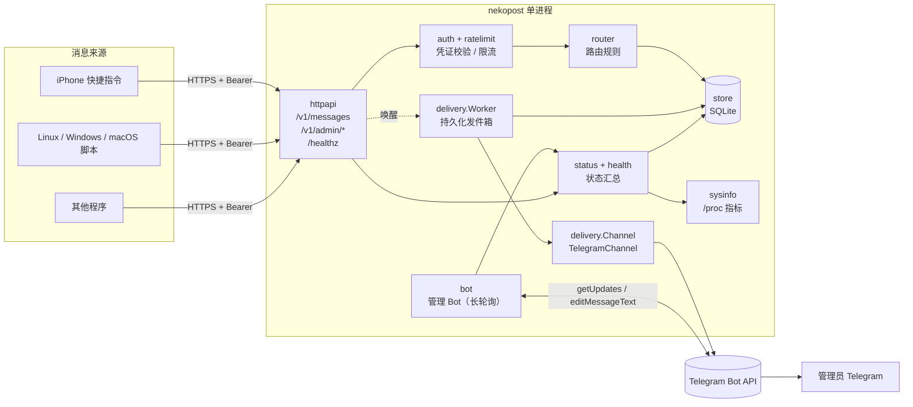
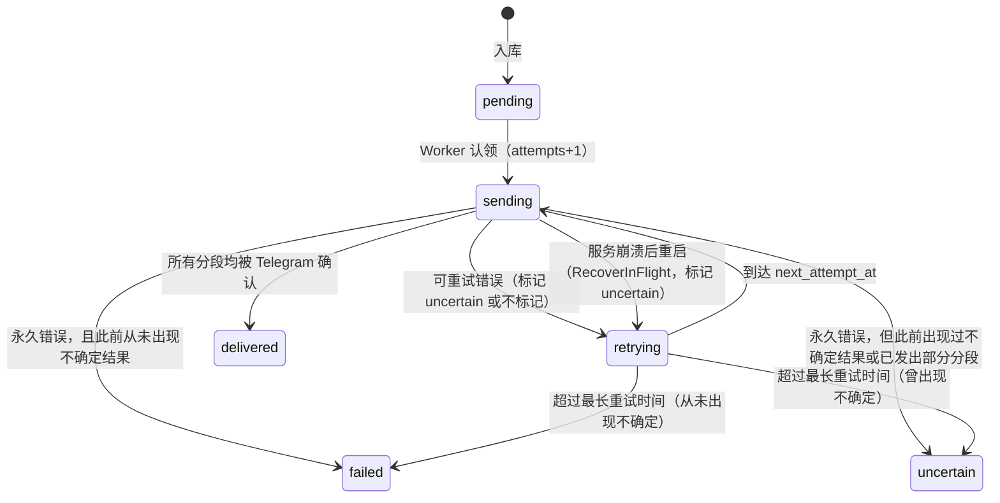

# 项目架构说明

nekopost（Personal Message Gateway）是一个单进程 Go 服务。它负责：接收各设备和程序提交的消息，统一格式后持久化，再可靠地转发到 Telegram；同时用一个 Telegram Bot 提供只读为主的管理入口。

## 1. 组件总览

请求路径（以提交一条消息为例）：

1. `httpapi` 校验来源凭证（`Authorization: Bearer mgs_...`），并按来源限流。
2. 解析 JSON 或纯文本，校验字段，规范化文本，生成统一的 `model.Message`。
3. `router.Router` 决定投递目标。第一版固定为“所有来源 → `telegram/default`”。
4. `store.InsertMessage` 在**一个事务里**完成：去重检查、写入元数据、写入正文（payload）、写入每个目标的 delivery 记录。事务提交后才响应客户端。
5. 唤醒 `delivery.Worker`。（启用短信过滤时，`sms` 类型的 delivery 以 `held` 状态入库，先唤醒 `filter.Filter`；分类后改为 `pending` 再唤醒 Worker，或改为 `filtered` 不投递。）Worker 取出到期的 delivery，交给对应的 `Channel` 发送，再记录结果。
6. 如果请求带了 `?wait=N`，HTTP 处理器会订阅这条消息的状态变化，最多等 N 秒（上限 25 秒），返回当时的真实状态。

## 2. 模块职责（`internal/*`）

| 包 | 职责 |
|---|---|
| `config` | 从环境变量和 `/etc/nekopost/nekopost.env` 读取配置，提供默认值并做格式校验；`ValidateServe` 检查运行服务所必需的项 |
| `model` | 统一数据模型：`Source`、`Message`、`Delivery`；消息状态与投递状态词汇；`AggregateStatus`；消息 ID 生成 |
| `auth` | 生成凭证（`mgs_` 来源凭证 / `mga_` 管理密钥，各含 256 位随机数），计算 SHA-256 摘要，解析 Bearer 头，计算带密钥的内容哈希（HMAC-SHA256，用于去重） |
| `store` | SQLite 持久化：迁移、来源与凭证、消息与投递、统计查询、数据保留清理 |
| `filter` | 短信过滤：本地识别验证码、遮盖数字和链接、调用 DeepSeek 分类；`Filter` 协程处理 `held` 状态的消息，出错时放行（见 [sms-filter.md](sms-filter.md)） |
| `router` | `Router` 接口；`Default` 实现：所有消息发往同一个目标，`low` 优先级静默投递 |
| `delivery` | `Channel` 接口、`TelegramChannel` 实现、`Worker`（发件箱处理与重试）、`Notifier`（供 `?wait` 等待状态变化） |
| `render` | 把消息渲染为 Telegram HTML 文本；超长时按 UTF-16 长度拆分成多条 |
| `telegram` | 最小化的 Bot API 客户端；返回的错误里绝不包含 Bot Token；能区分“请求已发出”和“请求未发出”两类网络错误 |
| `httpapi` | HTTP 路由、中间件（请求 ID、日志、并发上限、安全响应头）、提交与查询接口、只读管理接口、HTTPS 监听与自动证书 |
| `ratelimit` | 按来源的令牌桶；按客户端 IP 的认证失败封禁 |
| `health` | `Tracker` 记录实际观测（发送成功/失败、轮询成功/失败、接入、认证失败、Worker 心跳、近期错误）；`Evaluate` 把观测转换为各组件状态 |
| `status` | 按需汇总：健康报告、统计区间、来源活动、系统快照（5 秒内复用） |
| `sysinfo` | 读取 `/proc/uptime`、`/proc/loadavg`、`/proc/meminfo`、`/proc/stat`、`/proc/self/status` 和 `statfs`；不需要任何特权，不保存历史 |
| `bot` | 管理 Bot：长轮询、仅限管理员、仅限私聊、按钮菜单、需二次确认的启用/停用来源 |
| `sdnotify` | systemd 通知协议：`READY=1`、`STOPPING=1`、`WATCHDOG=1` |
| `app` | 组装所有组件；启动 HTTP、Worker、Bot、每小时维护任务和 watchdog；处理优雅关闭 |
| `cmd/nekopost` | 命令行：`serve`、`check`、`source …`、`admin-key …`、`version` |

## 3. 持久化

数据库：`$NEKOPOST_DATA_DIR/nekopost.db`（默认 `/var/lib/nekopost/nekopost.db`，文件权限 600）。

连接参数（`store.Open`）：

- `journal_mode=WAL`，`synchronous=FULL`：消息在事务提交后才向客户端确认，即使断电也不会丢失已确认的消息。
- `busy_timeout=5000`、`foreign_keys=1`、`_txlock=immediate`：写事务立即加锁，避免并发去重时出现竞态。
- `secure_delete=1`：删除的正文会在磁盘页上被覆盖。
- 每小时执行一次 `PRAGMA wal_checkpoint(TRUNCATE)`，避免已删除的数据残留在 WAL 文件中。

表结构概览（`internal/store/store.go`）：

| 表 | 内容 |
|---|---|
| `kv` | 内部键值：去重密钥 `secret:dedupe`、`last_start`、`start_count` |
| `sources` | 来源：id、名称、图标、是否启用、最近请求时间、已吊销凭证被使用的次数和时间 |
| `source_tokens` | 来源凭证：**仅存 SHA-256 摘要**和前 10 个字符的显示前缀；轮换后旧凭证记录 `revoked_at` |
| `admin_keys` | 管理 API 密钥（同样只存摘要） |
| `messages` | 消息元数据：来源、幂等键、内容 HMAC、类型、优先级、标题/正文长度、设备时间、接收时间、聚合状态、重复提交次数、完成时间。**不含正文** |
| `payloads` | 标题、正文、meta。**消息进入终态时在同一事务里删除** |
| `deliveries` | 每个（消息, 目标）一行：状态、尝试次数、分段进度、下次尝试时间、最近错误、`uncertain` 标记 |

数据保留：

- 正文：投递结束（送达 / 失败 / 不确定）即删除。另有每小时执行的兜底清理 `PurgeFinishedPayloads`。
- 元数据：保留 `NEKOPOST_RETENTION_DAYS`（默认 30 天）后删除，只删已完成的消息。维护任务在启动 1 分钟后首次运行，之后每小时一次。

## 4. 投递语义与状态机

语义是**至少一次**（at-least-once）：在无法确认结果时宁可重复，也不丢消息。

单个 delivery 的状态：

每次尝试的结果（`delivery.Outcome`）：

| 结果 | 何时出现 | 后续 |
|---|---|---|
| `Delivered` | 所有分段都收到 Telegram 的 `ok` | `delivered` |
| `RetrySafe` | 连接失败且请求未发出；HTTP 429；401/403/404；400 `chat not found` | `retrying`，不标记 uncertain |
| `RetryUncertain` | 请求已发出但没有收到响应（超时、连接中断）；Telegram 5xx | `retrying`，并把 `uncertain` 置 1 |
| `Permanent` | 其他 400（例如消息被拒） | `failed`；若此前出现过不确定或已发出部分分段，则为 `uncertain` |

其他细节：

- HTML 解析失败（400 `can't parse entities`）时，会用纯文本立即重发一次，不算一次失败。
- **崩溃恢复**：启动时，凡是仍处于 `sending` 的 delivery 都改为 `retrying` 并标记 `uncertain`，然后立即重试。这条消息可能会重复发出。
- **重试间隔**（`delivery.DefaultBackoff`）：5s、15s、30s、1m、2m、5m、10m、15m、30m，之后一直保持 30m，每次带 ±10% 随机抖动。如果 Telegram 返回 `retry_after` 且它更长，则使用 `retry_after + 1s`。
- **最长重试时间**：`NEKOPOST_DELIVERY_MAX_AGE`（默认 24h），从 delivery 创建时开始计算。如果下一次尝试会超过期限，或到期时还没投递成功，就进入终态（`failed` 或 `uncertain`）。
- **分段续传**：长消息会被拆成多段。每确认一段，就写入 `parts_sent`；重试时从下一段继续，已确认的分段不会重发。如果两次尝试之间渲染出的段数不同（例如升级了版本），则从头重发。
- **超时**：每次 `sendMessage` 30 秒，一次尝试（所有分段）最多 3 分钟。
- **节流**：同一个 Telegram 通道两次发送之间至少间隔 1.1 秒（`app.go` 中的 `MinInterval`），以遵守 Telegram 对单个聊天约每秒 1 条的限制。

消息的聚合状态（`model.AggregateStatus`）由它的所有 delivery 推导：有 `sending` 则为 `sending`；否则有 `retrying` 则为 `retrying`；否则有 `held` 则为 `classifying`；全部 `filtered` 则为 `filtered`；否则有 `pending` 则为 `queued`；全部 `delivered` 则为 `delivered`；部分送达则为 `partial`；否则有 `uncertain` 则为 `uncertain`；其余为 `failed`。没有任何目标时为 `not_routed`。

## 5. 健康与状态模型

`health.Tracker` 只记录**实际观测到的事件**；`health.Evaluate` 再据此计算 6 个组件的状态：

| key | 名称 | 依据 |
|---|---|---|
| `gateway` | 消息网关服务 | 数据库能否 Ping 通；Worker 心跳是否在 5 分钟内 |
| `ingest` | 消息接入 | HTTP 是否在监听；HTTPS 证书是否已取得、是否过期或 7 天内到期；最近一次有效提交的时间（作为外部可达性的证据） |
| `delivery` | Telegram 转发 | 最近一次发送成功或失败、失败类型、连续失败次数；最早待处理消息是否超过 5 分钟 |
| `bot` | 管理 Bot | 最近一次长轮询成功或失败；超过 3 分钟无通信即判为部分异常 |
| `sources` | 消息来源 | 是否配置了来源、是否全部停用、24 小时内是否有人使用已吊销的凭证 |
| `server` | 服务器资源 | 可用内存（<10% 部分异常，<5% 不可用）、磁盘剩余（<10% / <3%）、5 分钟负载是否超过 CPU 核数的 2 倍 |

状态级别：`ok` 🟢 正常、`unknown` ⚪ 无法确认、`degraded` 🟡 部分异常、`config_error` 🟠 配置错误、`down` 🔴 不可用。

原则：**没有证据就是“无法确认”，绝不是“正常”**。例如，启动后还没发过消息，`delivery` 就显示“尚无投递记录，无法确认”。整体状态取除 `unknown` 以外的最严重级别；如果全部正常但存在 `unknown`，显示为“正常运行（部分项目无法确认）”。

几种典型的部分故障可以被区分开来：

- 接入正常，但 Telegram 不可达：`ingest` 正常，`delivery` 和 `bot` 为不可用。
- 转发正常，但 Bot 被另一个实例占用（409）：`bot` 为配置错误，`delivery` 正常。
- 某个来源在用已吊销的凭证：只有 `sources` 降级。

存活探针 `/healthz` 只反映进程本身（数据库可用、Worker 存活），**不包含 Telegram 的状态**。原因是 Telegram 故障时重启服务没有帮助。systemd watchdog 使用同样的判断条件。

## 6. 资源设计

- **单进程、单 Worker**：所有投递串行处理，内存占用稳定，也天然满足 Telegram 的频率限制。
- **长轮询**：Bot 使用 `getUpdates`（timeout 50 秒），空闲时大约每 50 秒一次请求，不需要入站 webhook。
- **不在后台采集指标**：只在查询时读取 `/proc`（CPU 采样约 0.3 秒，结果 5 秒内复用），不保存历史数据。
- **空闲时 Worker 的行为**：每 30 秒最多查询一次到期任务；有到期任务时按 `next_attempt_at` 精确唤醒；新消息入库后立即唤醒。
- **内存限制**：systemd 中设置 `GOMEMLIMIT=64MiB` 和 `MemoryMax=160M`。HTTP 并发处理上限为 32，超出时返回 `503 busy`。
- **依赖**：只有 `modernc.org/sqlite`（纯 Go，无需 cgo）和 `golang.org/x/crypto/acme/autocert`。

## 7. 为什么用 systemd 而不是 Docker

需求文档原本写的是 Docker 部署。评估后，用户决定改用 Go 单文件 + systemd，原因如下：

- 目标服务器只有 1 vCPU、约 1 GB 内存。Docker 守护进程（dockerd + containerd）常驻就要占用几十 MB 到上百 MB，比网关本身还多。
- 不需要额外处理容器网络、IPv6、镜像拉取，以及从容器内读取宿主机指标等问题。
- Docker 能提供的自动重启、开机自启、日志、资源限制和沙箱，systemd 都能提供：`Restart=always`、journald、`MemoryMax`、`ProtectSystem=strict`、`NoNewPrivileges`、`SystemCallFilter` 等，见 `deploy/nekopost.service`。
- 部署和升级只需替换一个二进制文件再重启，见 `deploy/install.sh`。
- 服务以专用的 `nekopost` 用户运行，只通过 `CAP_NET_BIND_SERVICE` 绑定 80/443 端口，不挂载任何 Docker socket，也不需要 root。
